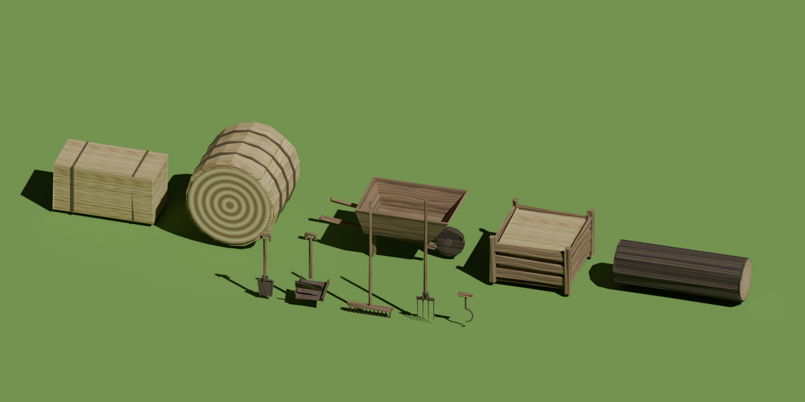

# Blender asset pipeline

Game props are built from Python (`bpy`) scripts, so every model is
reproducible and tweakable by editing numbers instead of hand-modeling.

## House style: LT2 shapes, Rustic finish

Every prop uses Lumber Tycoon 2 style shapes (blocks and cylinders, small
bevels) with the **Rustic** finish: muted, weathered straw / bark / plank
textures, rusty metal, dull twine, and slightly uneven surfaces. It lives in
`lib/style.py`; build new props with `style.rustic()` so they match.



```
blender/
  lib/common.py            scene reset, materials, textures, join, export, preview render
  lib/style.py             the house style (palettes, textures, Finish) and shape helpers
  props/rustic_props.py    every game prop, one .glb each + a catalog render
  props/hay_bale.py        square bale shape (4x2x2 studs, stackable)
  styles/lt2_mockups.py    the six finishes that were compared when picking the style
  tools/render_preview.py  renders a PNG preview of any exported .glb
  exports/rustic/          the game-ready props (.glb) and catalog.png
  exports/styles/          the style comparison renders
```

## Props

| file | size (studs) | notes |
|---|---|---|
| `hay_bale.glb` | 4 x 2 x 2 | stacks: two side by side = one across the top |
| `round_bale.glb` | 3.6 x 3.4 x 3.6 | rolled hay with twine |
| `basic_shovel.glb` | ~2.7 tall | small spade (starter tool) |
| `wide_scoop.glb` | ~3 tall | broad grain scoop |
| `garden_rake.glb` | ~5 tall | iron-tooth rake |
| `pitchfork.glb` | ~5 tall | four tines |
| `hay_hook.glb` | ~1.4 tall | T handle with hook, for dragging bales |
| `wheelbarrow.glb` | ~5 x 2.5 x 2.5 | wooden tray, one wheel |
| `hay_crate.glb` | 3 x 3 x 2 | slatted crate holding hay |
| `log.glb` | 5 long | bark with end-grain rings |

## Build

With Blender installed (4.2+ / 5.x):

```sh
blender --background --python blender/props/rustic_props.py -- --out blender/exports/rustic
# just some:  ... -- --out blender/exports/rustic --only basic_shovel,log
```

Without Blender, the `bpy` pip module works the same way (needs Python 3.13
for bpy 5.x):

```sh
python3.13 -m venv .bpyenv
.bpyenv/bin/pip install bpy==5.2.2
.bpyenv/bin/python blender/props/rustic_props.py --out blender/exports/rustic
```

Harmless log noise: "Draco is not available" / "MeshOptimizer is not
available" come from the pip `bpy` build and don't affect the export.

Preview any export:

```sh
blender --background --python blender/tools/render_preview.py -- blender/exports/rustic/log.glb log.png
```

## Import into Roblox

1. Studio → **Home → Import 3D**, pick a `.glb` from `exports/rustic/`.
2. Keep **Import as a model**. Textures are embedded in the .glb and come in
   with the mesh.
3. Scale: props are modeled in meters. If the importer doesn't convert, 1 stud
   = 0.28 m, so scale by ~3.57 (a hay bale should be 4 x 2 x 2 studs).

## Adding a new prop

Write a builder in `props/rustic_props.py` that makes parts with
`cyl()` / `box()`, passes each through `f.shape(part)` and
`f.apply(part, kind)` (kind is hay, bark, wood, handle, metal or twine), and
add it to `PROPS`. Keep each prop under a few thousand triangles.
